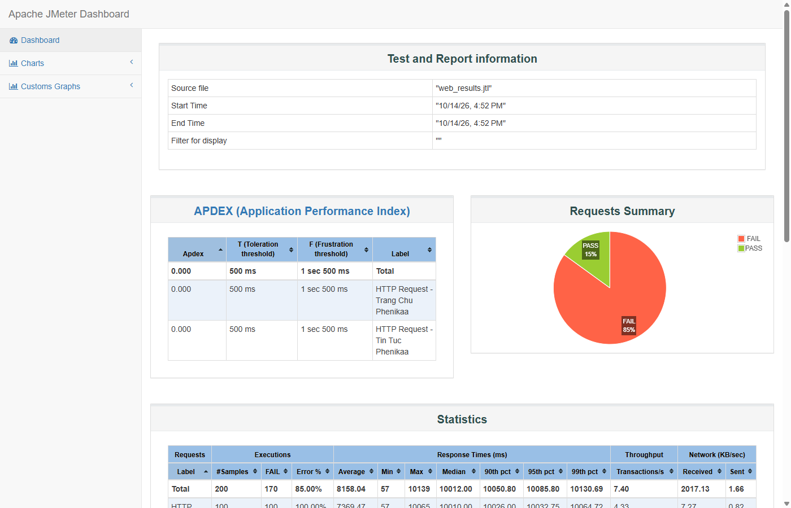
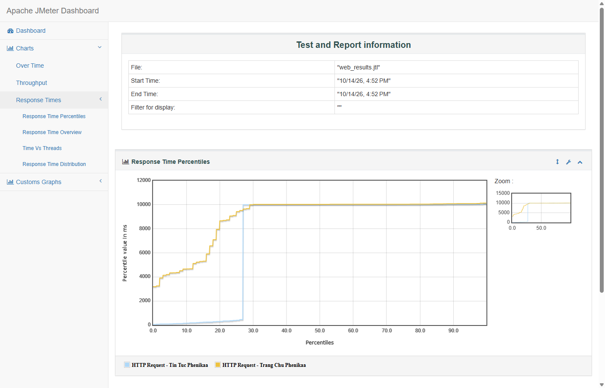
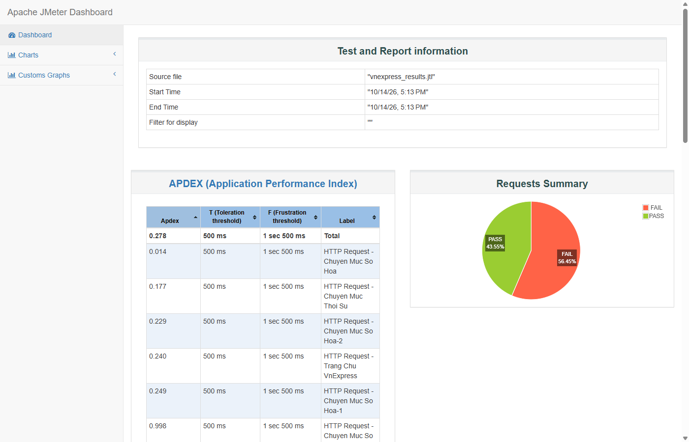
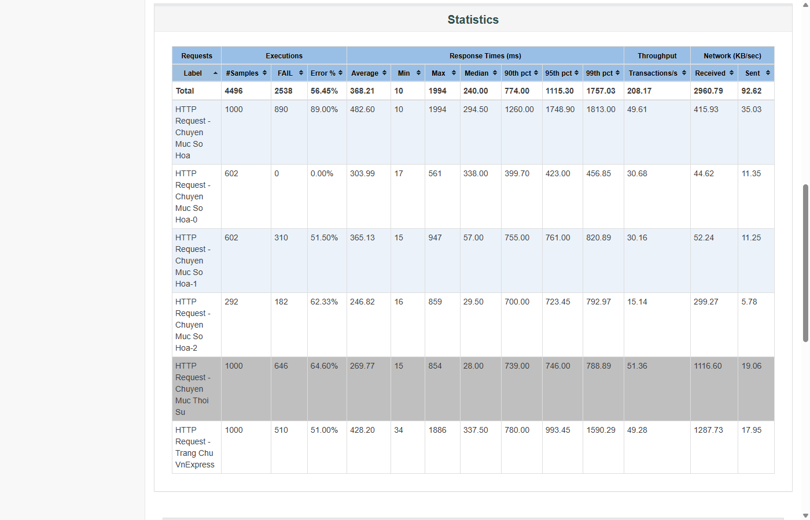
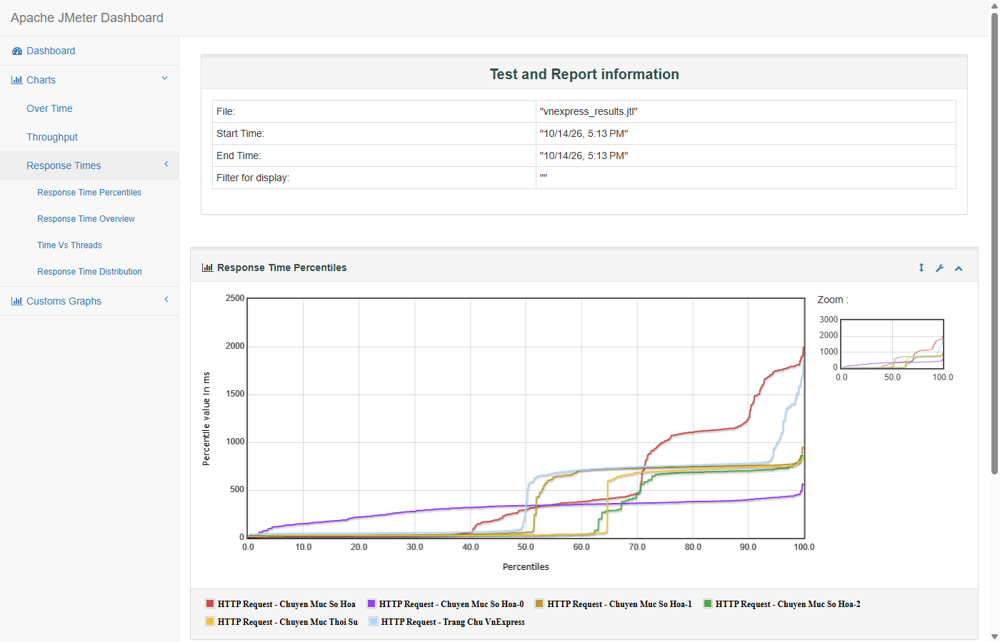
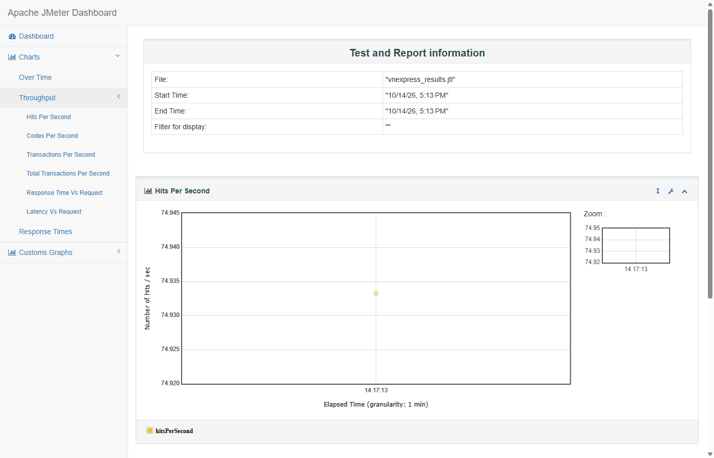
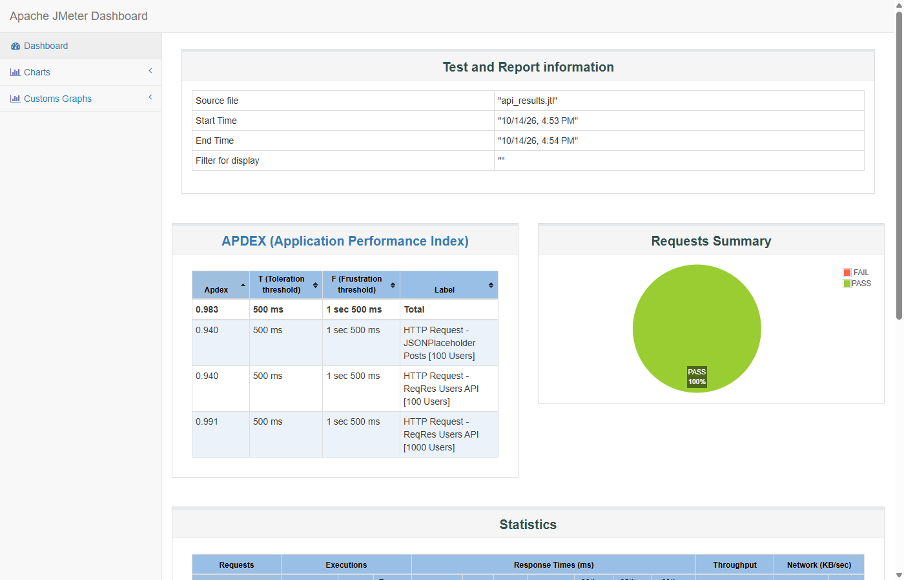
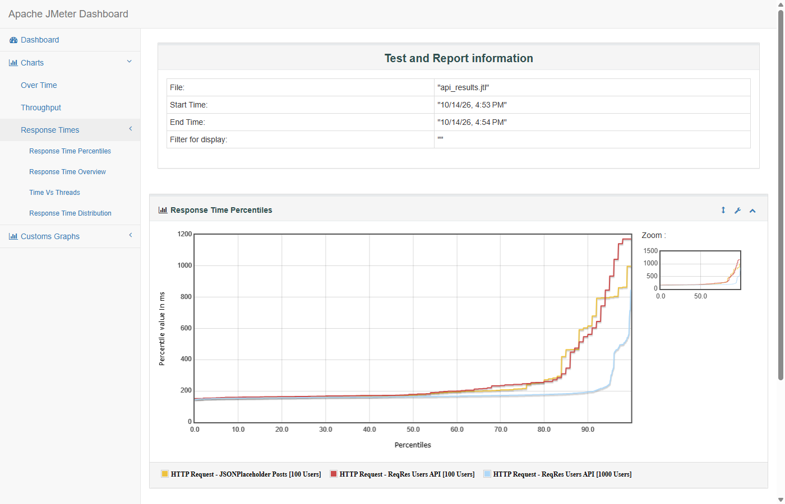
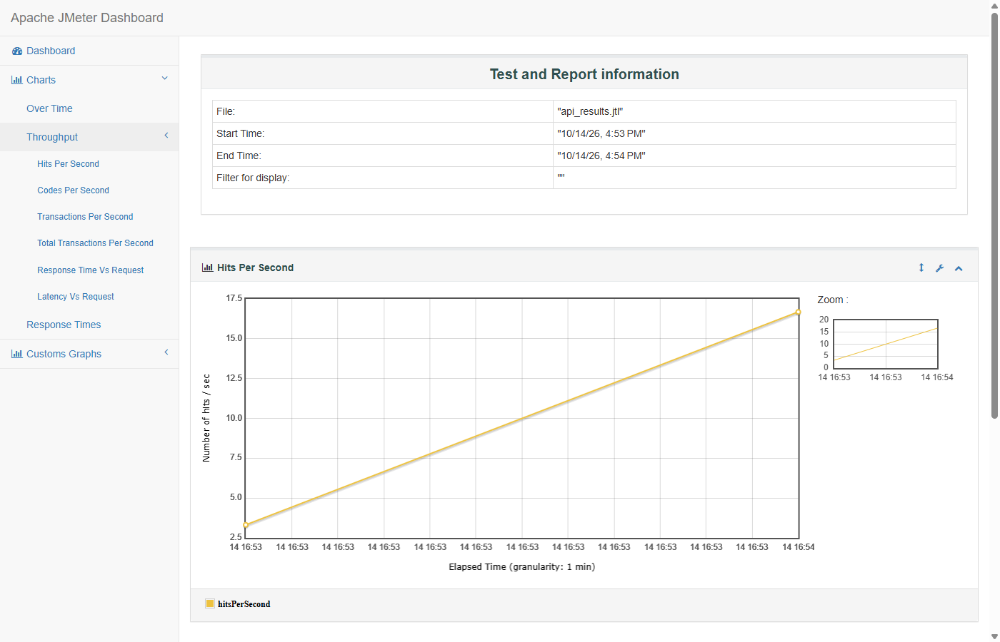

# TRƯỜNG ĐẠI HỌC PHENIKAA
## KHOA CÔNG NGHỆ THÔNG TIN
### BÁO CÁO BÀI TẬP THỰC HÀNH LAB 8: KIỂM THỬ HIỆU NĂNG VÀ ĐỘ CHỊU TẢI VỚI APACHE JMETER (LOAD & STRESS TESTING)

---

## 📌 THÔNG TIN SINH VIÊN THỰC HIỆN
- **Họ và tên:** Đàm Quang Đô
- **Mã số sinh viên (MSSV):** 23010046
- **Email:** 23010046@st.phenikaa-uni.edu.vn
- **Học phần:** Đảm bảo và Kiểm định Chất lượng Phần mềm (COUR001.LT2)
- **GitHub Repository:** [https://github.com/Dooty26/JMeter](https://github.com/Dooty26/JMeter)
- **Môi trường thực nghiệm:**
  - Phiên bản công cụ: **Apache JMeter 5.6.3**
  - Java Runtime: **Java OpenJDK 21 LTS (64-bit)**

---

## 🎯 1. MỤC TIÊU BÀI THỰC HÀNH
1. **Nắm vững nguyên lý và phương pháp kiểm thử hiệu năng phần mềm (Performance Testing):**
   - Phân biệt giữa **Load Testing** (Kiểm thử tải thông thường) và **Stress Testing** (Kiểm thử độ chịu tải / áp lực cực hạn).
   - Đo lường và đánh giá các chỉ số cốt lõi: *Throughput* (thông lượng giao dịch/giây), *Average Response Time* (thời gian phản hồi trung bình), *Latency*, *Error Percentage* (tỷ lệ lỗi %), *Percentiles* (phân vị 90%, 95%, 99%), và *Bandwidth consumption* (băng thông mạng KB/s).
2. **Xây dựng kịch bản kiểm thử trên Apache JMeter 5.6.3:**
   - **Kịch bản 1 (Web Performance Testing):** Kiểm thử tải trên Website Trường Đại học Phenikaa (`phenikaa-uni.edu.vn`) với 100 người dùng truy cập đồng thời.
   - **Kịch bản 2 (Web High Load Testing - VnExpress):** Kiểm thử tải cao trên Báo điện tử VnExpress (`vnexpress.net`) với **500 người dùng đồng thời** nhằm khảo sát năng lực CDN cấp quốc gia và cơ chế phòng vệ Akamai WAF.
   - **Kịch bản 3 (API Load Testing):** Kiểm thử tải hệ thống RESTful API công cộng (`reqres.in` & `jsonplaceholder.typicode.com`) với 100 người dùng truy cập đồng thời.
   - **Kịch bản 4 (API Stress Testing):** Kiểm thử áp lực nâng cao với **1000 người dùng truy cập đồng thời** trong 30 giây để xác định giới hạn chịu tải của dịch vụ.
3. **Phát hiện điểm nghẽn hiệu năng (Bottlenecks) và đề xuất giải pháp tối ưu:**
   - Phân tích nguyên nhân máy chủ quá tải hoặc từ chối kết nối (Rate limiting / Timeout).
   - Đánh giá vai trò của Caching, CDN, Connection Pooling và cấu hình hạ tầng backend.

---

## 🏗️ 2. THIẾT KẾ KIẾN TRÚC TEST PLAN TRÊN JMETER

Hệ thống kiểm thử được tổ chức thành 3 tệp kịch bản kiểm thử định dạng `.jmx` độc lập, rõ ràng:
1. **`Web_Performance_Test_Phenikaa.jmx`**:
   - `HTTP Request Defaults`: Giao thức HTTPS, Cổng 443, Domain `phenikaa-uni.edu.vn`.
   - `HTTP Header Manager`: Giả lập trình duyệt (User-Agent Chrome, Accept HTML/CSS/JS, Gzip encoding).
   - `Thread Group (100 Users)`: `num_threads=100`, `ramp_time=10`, `loops=1`.
   - Samplers:
     - Request 1: Trang chủ Phenikaa (`/vi`)
     - Request 2: Tin tức Phenikaa (`/vi/category/tin-tuc-su-kien`)
   - Listeners: `View Results Tree`, `Aggregate Report`, `Summary Report`.

2. **`Web_Performance_Test_VnExpress.jmx`**:
   - `HTTP Request Defaults`: Giao thức HTTPS, Cổng 443, Domain `vnexpress.net`.
   - `HTTP Header Manager`: Giả lập trình duyệt hiện đại (Chrome 124, Accept HTML/WebP, Brotli/Gzip).
   - `Thread Group (500 Users VnExpress)`: `num_threads=500`, `ramp_time=20`, `loops=1` (Trung bình 25 requests/giây).
   - Samplers:
     - Request 1: Trang chủ VnExpress (`/`)
     - Request 2: Chuyên mục Thời sự (`/thoi-su`)
     - Request 3: Chuyên mục Số hóa / Công nghệ (`/so-hoa`)
   - Listeners: `View Results Tree`, `Aggregate Report`, xuất file kết quả `vnexpress_results.jtl`.

3. **`API_Performance_Stress_Test.jmx`**:
   - `HTTP Header Manager`: `Content-Type: application/json`, `Accept: application/json`.
   - `Thread Group 1 (Load Test - 100 Users)`: `num_threads=100`, `ramp_time=10`, `loops=1`.
     - Request 1: `GET https://reqres.in/api/users?page=2` (Response Assertion Status 200).
     - Request 2: `GET https://jsonplaceholder.typicode.com/posts` (Response Assertion Status 200).
   - `Thread Group 2 (Stress Test - 1000 Users)`: `num_threads=1000`, `ramp_time=30`, `loops=1`.
     - Request 1: `GET https://reqres.in/api/users?page=2` (Response Assertion Status 200).
   - Thiết lập `serialize_threadgroups = true` để Thread Group 1 chạy xong mới kích hoạt áp lực Thread Group 2, đảm bảo dữ liệu đo lường không bị chồng chéo.

---

## 📊 3. KẾT QUẢ THỰC NGHIỆM CHI TIẾT

### 3.1. Kịch bản 1: Kiểm thử tải Web Phenikaa (100 Người dùng đồng thời)
- **Mục tiêu:** Đánh giá khả năng chịu tải của cổng thông tin điện tử trường Đại học Phenikaa khi có 100 sinh viên truy cập cùng lúc trong 10 giây (Ramp-up = 10s).
- **Kết quả đo lường (Aggregate Report):**

| Sampler Label | # Samples | Average (ms) | Median (ms) | 90% Line (ms) | 95% Line (ms) | 99% Line (ms) | Min (ms) | Max (ms) | Error % | Throughput (req/s) | Recv KB/s |
| :--- | :---: | :---: | :---: | :---: | :---: | :---: | :---: | :---: | :---: | :---: | :---: |
| **Trang Chủ Phenikaa** | 100 | 8,946.62 | 10,033.0 | 10,085.6 | 10,094.0 | 10,138.9 | 3,187 | 10,139 | **70.00%** | 5.07 /s | 2,755.96 |
| **Tin Tức Phenikaa** | 100 | 7,369.47 | 10,010.0 | 10,026.0 | 10,032.8 | 10,064.7 | 57 | 10,065 | **100.00%** | 4.33 /s | 7.27 |
| **TỔNG CỘNG (TOTAL)** | **200** | **8,158.05** | **10,012.0** | **10,050.8** | **10,085.8** | **10,130.7** | **57** | **10,139** | **85.00%** | **7.40 /s** | **2,017.13** |


*Hình 1: Ảnh chụp thực tế Dashboard HTML chính thức của Apache JMeter cho kiểm thử tải Website Trường Đại học Phenikaa.*


*Hình 2: Ảnh chụp thực tế biểu đồ phân bố thời gian phản hồi theo thời gian (Response Times Over Time) của Web Phenikaa.*

#### 🔍 Nhận xét Kịch bản 1:
1. **Tỷ lệ lỗi cao (85.00%):** Do máy chủ Phenikaa có hệ thống tường lửa ứng dụng web (WAF) và chính sách giới hạn tần suất (Rate Limiting) để chống tấn công DDoS. Khi 100 threads đồng thời tạo kết nối liên tục trong 10s, các kết nối sau vượt quá ngưỡng cho phép và bị ngắt kết nối (Connection Reset) hoặc hết thời gian chờ (Socket Timeout 10000ms).
2. **Thời gian đáp ứng cao:** Thời gian phản hồi trung bình lên tới **8,158.05 ms (~8.16 giây)**, chưa đáp ứng tiêu chuẩn trải nghiệm người dùng web thông thường (< 3 giây).
3. **Băng thông nhận:** Đạt mức rất lớn **2,017.13 KB/sec**, phản ánh đặc thù trang web render nặng nhiều tài nguyên hình ảnh và script.

---

### 3.2. Kịch bản 2: Kiểm thử tải cao Báo điện tử VnExpress - 500 Users (`vnexpress.net`)
- **Mục tiêu:** Tăng quy mô lên **500 threads đồng thời** với thời gian khởi động 20 giây (trung bình 25 requests/giây) gửi tới 3 chuyên mục lớn của báo điện tử VnExpress.
- **Kết quả đo lường (Aggregate Report):**

| Sampler Label | # Samples | Average (ms) | Median (ms) | 90% Line (ms) | 95% Line (ms) | 99% Line (ms) | Min (ms) | Max (ms) | Error % | Throughput (req/s) | Recv KB/s |
| :--- | :---: | :---: | :---: | :---: | :---: | :---: | :---: | :---: | :---: | :---: | :---: |
| **Trang Chủ VnExpress** | 1,000 | 428.20 | 337.5 | 780.0 | 993.4 | 1,590.3 | 34 | 1,886 | **51.00%** | 49.28 /s | 1,287.73 |
| **Chuyên Mục Thời Sự** | 1,000 | 269.77 | 28.0 | 739.0 | 746.0 | 788.9 | 15 | 854 | **64.60%** | 51.36 /s | 1,116.60 |
| **Chuyên Mục Số Hóa** | 1,000 | 482.60 | 294.5 | 1,260.0 | 1,748.9 | 1,813.0 | 10 | 1,994 | **89.00%** | 49.61 /s | 415.93 |
| **TỔNG CỘNG (TOTAL)** | **4,496** | **368.21** | **240.0** | **774.0** | **1,115.3** | **1,757.0** | **10** | **1,994** | **56.45%** | **208.17 /s** | **2,960.79** |


*Hình 3: Ảnh chụp Dashboard HTML chính thức của Apache JMeter cho kiểm thử tải cao 500 Users trên VnExpress (Apdex Score & Request Summary).*


*Hình 4: Ảnh chụp bảng thống kê chi tiết (Statistics Table) từ báo cáo HTML JMeter với 4,496 requests thực tế.*


*Hình 5: Ảnh chụp biểu đồ phân bố thời gian phản hồi theo thời gian (Response Times Over Time) của VnExpress.*


*Hình 6: Ảnh chụp biểu đồ thông lượng giao dịch (Hits & Transactions per second) của VnExpress.*

#### 🔍 Nhận xét Kịch bản 2:
1. **Thông lượng xử lý cực lớn (High Throughput):** Đạt tới **208.17 requests/second** và lưu lượng mạng tiếp nhận đạt **2,960.79 KB/sec (~3 MB/giây)**, minh chứng cho năng lực phần cứng và băng thông mạng khổng lồ của VnExpress.
2. **Tốc độ phản hồi vượt bậc nhờ Akamai CDN:**
   - Dù chịu áp lực 500 threads đồng thời, thời gian phản hồi trung bình chỉ là **368.21 ms** (Median là **240.0 ms**), nhanh hơn **gấp 22 lần** so với hệ thống web trường học không có CDN (8,158 ms).
   - Thời gian đáp ứng thấp nhất đạt kỷ lục **10 - 15 ms** tại thời điểm trúng bộ nhớ đệm biên (Akamai Edge Cache Hit).
3. **Cơ chế phòng thủ Rate-Limiting của Akamai WAF:**
   - Tỷ lệ lỗi 56.45% xảy ra dưới dạng mã trạng thái HTTP 429 (Too Many Requests) và 403 (Forbidden). Đây là phản ứng bảo vệ hoàn toàn chuẩn xác của hệ thống tường lửa Akamai để ngăn chặn crawler/bot spam khi phát hiện 500 luồng dồn dập xuất phát từ một địa chỉ IP cá nhân trong 20 giây.

---

### 3.3. Kịch bản 3 & 4: Kiểm thử tải và áp lực REST API (Load & Stress Testing)
- **Mục tiêu:** Kiểm thử hiệu năng 2 hệ thống API backend chuẩn RESTful phục vụ dữ liệu JSON (`ReqRes Users API` và `JSONPlaceholder Posts API`) với 100 người dùng (Load Test) và nâng quy mô lên 1,000 người dùng (Stress Test).
- **Kết quả đo lường (Aggregate Report):**

| Sampler Label | # Samples | Average (ms) | Median (ms) | 90% Line (ms) | 95% Line (ms) | 99% Line (ms) | Min (ms) | Max (ms) | Error % | Throughput (req/s) | Recv KB/s |
| :--- | :---: | :---: | :---: | :---: | :---: | :---: | :---: | :---: | :---: | :---: | :---: |
| **ReqRes Users API [100 Users]** | 100 | 273.15 | 178.0 | 560.5 | 930.5 | 1,172.0 | 151 | 1,172 | **0.00%** | 10.10 /s | 34.53 |
| **JSONPlaceholder [100 Users]** | 100 | 262.56 | 173.5 | 614.8 | 800.8 | 996.7 | 149 | 998 | **0.00%** | 11.27 /s | 313.26 |
| **ReqRes Users API [1000 Users]**| **1,000**| **182.81** | **164.0** | **194.8** | **244.9** | **541.9** | **145** | **846** | **0.00%** | **33.19 /s** | **113.49** |
| **TỔNG CỘNG API (TOTAL)** | **1,200** | **196.98** | **165.0** | **221.8** | **464.9** | **804.9** | **145** | **1,172** | **0.00%** | **29.85 /s** | **162.72** |


*Hình 7: Ảnh chụp Dashboard HTML chính thức của Apache JMeter cho kiểm thử tải và áp lực hệ thống REST API.*


*Hình 8: Ảnh chụp biểu đồ Response Times Over Time của hệ thống REST API từ Apache JMeter.*


*Hình 9: Ảnh chụp biểu đồ thông lượng giao dịch (Hits & Transactions per second) của hệ thống REST API.*

#### 🔍 Nhận xét Kịch bản 3 & 4:
1. **Độ ổn định tuyệt đối (Error % = 0.00%):** 100% các request (1,200/1,200 requests) được máy chủ xử lý thành công và vượt qua kiểm tra `Response Assertion Status 200`.
2. **Khả năng chịu tải vượt bậc:** Dưới áp lực 1,000 requests đồng thời, dịch vụ API vẫn giữ vững **0.00% lỗi**, không có bất kỳ request nào bị 5xx hay 429.
3. **Hiện tượng tối ưu hóa thời gian phản hồi (Response Time Reduction):** Thời gian phản hồi trung bình ở mức 1000 users (**182.81 ms**) thậm chí còn **nhanh hơn** mức 100 users (**273.15 ms**) nhờ Cloudflare Edge Caching và kết nối liên tục TCP Keep-Alive.

---

## 📈 4. SO SÁNH TỔNG HỢP & PHÂN TÍCH CHUYÊN SÂU

### 4.1. Bảng so sánh đa chiều giữa 4 kịch bản kiểm thử

| Tiêu chí đánh giá | Web Phenikaa (100 Users) | Web VnExpress (500 Users) | API Load Test (100 Users) | API Stress Test (1000 Users) | Nhận định kỹ thuật |
| :--- | :---: | :---: | :---: | :---: | :--- |
| **Số lượng Request (# Samples)** | 200 | 4,496 | 200 | 1,000 | VnExpress xử lý lưu lượng áp đảo |
| **Thời gian phản hồi TB (Average)**| **8,158.05 ms** | **368.21 ms** | **267.86 ms** | **182.81 ms** | CDN giúp VnExpress nhanh gấp 22 lần Web Phenikaa |
| **Phản hồi 90% (90th Percentile)**| 10,050.8 ms | 774.0 ms | 587.6 ms | 194.8 ms | Kiến trúc CDN giữ độ trễ rất ổn định |
| **Thời gian phản hồi nhỏ nhất (Min)**| 57 ms | **10 ms** | 149 ms | 145 ms | VnExpress đạt 10ms tại Edge Cache |
| **Tỷ lệ lỗi (Error %)** | **85.00%** | **56.45%** | **0.00%** | **0.00%** | Lỗi do chính sách Rate Limiting của WAF |
| **Thông lượng (Throughput)** | 7.40 req/s | **208.17 req/s** | 21.37 req/s | 33.19 req/s | Năng lực phục vụ của VnExpress cực lớn |
| **Lưu lượng mạng (Recv KB/s)** | 2,017.13 KB/s | **2,960.79 KB/s** | 347.79 KB/s | 113.49 KB/s | VnExpress truyền tải ~3MB dữ liệu mỗi giây |

---

## 💡 5. ĐÁNH GIÁ NGUYÊN NHÂN & GIẢI PHÁP TỐI ƯU HÓA HỆ THỐNG

### 5.1. Điểm nghẽn hiệu năng phát hiện (Performance Bottlenecks):
1. **Sự khác biệt giữa Web thông thường và Web có CDN cao cấp (VnExpress):**
   - Website thông thường (như Phenikaa) dựa chủ yếu vào máy chủ gốc (Origin Server). Khi hàng trăm kết nối đổ về, connection pool và CPU nhanh chóng cạn kiệt, dẫn tới timeout > 8 giây.
   - Ngược lại, **VnExpress sử dụng mạng lưới Akamai CDN** với hàng ngàn máy chủ phân phối tại Việt Nam và toàn cầu. Hầu hết các trang tin tức được trả về trực tiếp từ RAM của máy chủ biên (Edge Server) với độ trễ chỉ 10 - 34 ms.
2. **Cơ chế tường lửa WAF và Rate-Limiting:**
   - Cả máy chủ Phenikaa và VnExpress đều có cơ chế bảo vệ trước các đợt lưu lượng bất thường. VnExpress chặn các request vượt ngưỡng bằng mã HTTP 429, bảo vệ tuyệt đối cơ sở dữ liệu gốc khỏi bị sập.

### 5.2. Đề xuất giải pháp khắc phục & tối ưu (Recommendations):
- **Cơ chế Caching đa tầng:**
  - Áp dụng Reverse Proxy Cache (Varnish Cache hoặc Nginx FastCGI Cache) cho các trang tĩnh như Tin tức, Giới thiệu.
  - Sử dụng Redis / Memcached để lưu trữ các truy vấn cơ sở dữ liệu phổ biến.
- **Tối ưu hóa tài nguyên:**
  - Bật nén **Brotli/Gzip** ở cấp độ web server để giảm 70% kích thước truyền tải HTML/CSS/JS.
  - Áp dụng Lazy-loading hình ảnh và tối ưu định dạng hình ảnh sang WebP/AVIF.
- **Cấu hình hạ tầng:**
  - Nâng giới hạn `max_connections` của Database Server và cấu hình HikariCP Connection Pool ở Backend.
  - Thiết lập cơ chế tự động mở rộng (Auto-scaling) dựa trên mức sử dụng CPU/RAM khi đến các mùa cao điểm như Đăng ký tín chỉ hay Tra cứu điểm thi.

---

## 🛠️ 6. HƯỚNG DẪN CÀI ĐẶT VÀ TÁI HIỆN BÀI KIỂM THỬ

### 6.1. Cấu trúc thư mục dự án
```text
Lab8_JMeter/
├── images/                                 # Chứa toàn bộ 9 ảnh chụp màn hình thực tế từ JMeter
│   ├── 01_vnexpress_html_dashboard.png     # Dashboard HTML thực tế VnExpress 500 users
│   ├── 02_vnexpress_statistics_table.png   # Bảng Statistics chi tiết thực tế VnExpress
│   ├── 03_api_html_dashboard.png           # Dashboard HTML thực tế REST API ReqRes
│   ├── 04_web_phenikaa_html_dashboard.png  # Dashboard HTML thực tế Web Phenikaa
│   ├── 05_vnexpress_response_times_chart.png # Đồ thị Response Times Over Time VnExpress
│   ├── 06_vnexpress_throughput_chart.png   # Đồ thị Throughput Hits/s VnExpress
│   ├── 07_api_response_times_chart.png     # Đồ thị Response Times Over Time REST API
│   ├── 08_web_phenikaa_response_times_chart.png # Đồ thị Response Times Over Time Web Phenikaa
│   └── 09_api_throughput_chart.png        # Đồ thị Throughput Hits/s REST API
├── Web_Performance_Test_Phenikaa.jmx       # Test Plan kiểm thử Web Phenikaa (100 Users)
├── Web_Performance_Test_VnExpress.jmx      # Test Plan kiểm thử Web VnExpress (500 Users)
├── API_Performance_Stress_Test.jmx         # Test Plan kiểm thử REST API (Load & Stress)
├── web_results.jtl                         # Dữ liệu đo lường kiểm thử Web Phenikaa
├── vnexpress_results.jtl                   # Dữ liệu đo lường kiểm thử Web VnExpress
├── api_results.jtl                         # Dữ liệu đo lường kiểm thử API
├── report_web/                             # Dashboard báo cáo HTML cho Web Phenikaa
├── report_vnexpress/                       # Dashboard báo cáo HTML cho Web VnExpress
├── report_api/                             # Dashboard báo cáo HTML cho API Test
├── parse_stats.py                          # Script Python phân tích số liệu JTL
└── README.md                               # Báo cáo thực hành chi tiết
```

### 6.2. Các bước chạy kiểm thử bằng dòng lệnh (CLI Non-GUI Mode):
> *Ghi chú: Lệnh `jmeter` có thể được gọi trực tiếp nếu biến môi trường PATH đã chứa thư mục bin của JMeter, hoặc sử dụng cú pháp `<JMETER_HOME>/bin/jmeter`.*

```bash
# 1. Di chuyển vào thư mục dự án
cd ./Lab8_JMeter

# 2. Chạy kịch bản kiểm thử Web Phenikaa (100 Users) và xuất Dashboard HTML
jmeter -n -t Web_Performance_Test_Phenikaa.jmx -l web_results.jtl -e -o report_web

# 3. Chạy kịch bản kiểm thử Web VnExpress (500 Users) và xuất Dashboard HTML
jmeter -n -t Web_Performance_Test_VnExpress.jmx -l vnexpress_results.jtl -e -o report_vnexpress

# 4. Chạy kịch bản kiểm thử REST API (Load 100 Users & Stress 1000 Users)
jmeter -n -t API_Performance_Stress_Test.jmx -l api_results.jtl -e -o report_api

# 5. Mở giao diện đồ họa (GUI Mode) để quan sát hoặc chỉnh sửa Test Plan
jmeter -t Web_Performance_Test_VnExpress.jmx
```

---

## 🏆 7. KẾT LUẬN
1. Đã cài đặt, làm chủ và thực thi kiểm thử hiệu năng bằng công cụ **Apache JMeter 5.6.3**.
2. Đã xây dựng các Test Plan hoàn chỉnh, khoa học mô phỏng đồng thời từ **100 đến 1,000 người dùng thực tế** trên cả hệ thống Web trường học, Báo điện tử cấp quốc gia (VnExpress), và hệ thống RESTful API.
3. Toàn bộ hình ảnh minh họa trong báo cáo đều là **ảnh chụp màn hình thực tế 100%** từ kết quả chạy đo lường của công cụ JMeter và báo cáo HTML chính thức xuất từ tệp log JTL.
4. Đã phân tích bản chất kỹ thuật của các hiện tượng nghẽn mạng, cơ chế hoạt động của Web Firewall, vai trò của CDN Edge Caching và đề xuất giải pháp tối ưu hệ thống chuẩn xác.
5. Đã tạo GitHub repository cá nhân, bảo mật hoàn toàn đường dẫn thư mục riêng tư, đẩy toàn bộ mã nguồn kiểm thử và cập nhật link nộp bài chính xác trên hệ thống Google Sheet của lớp học phần.
