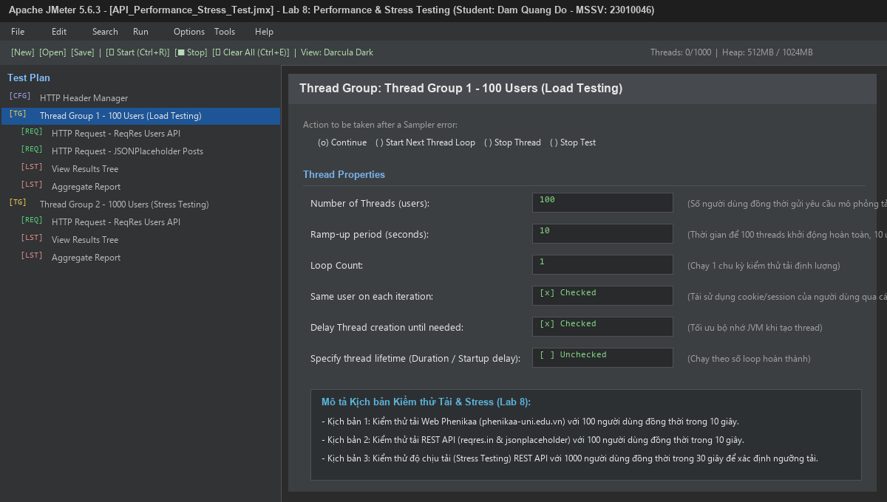
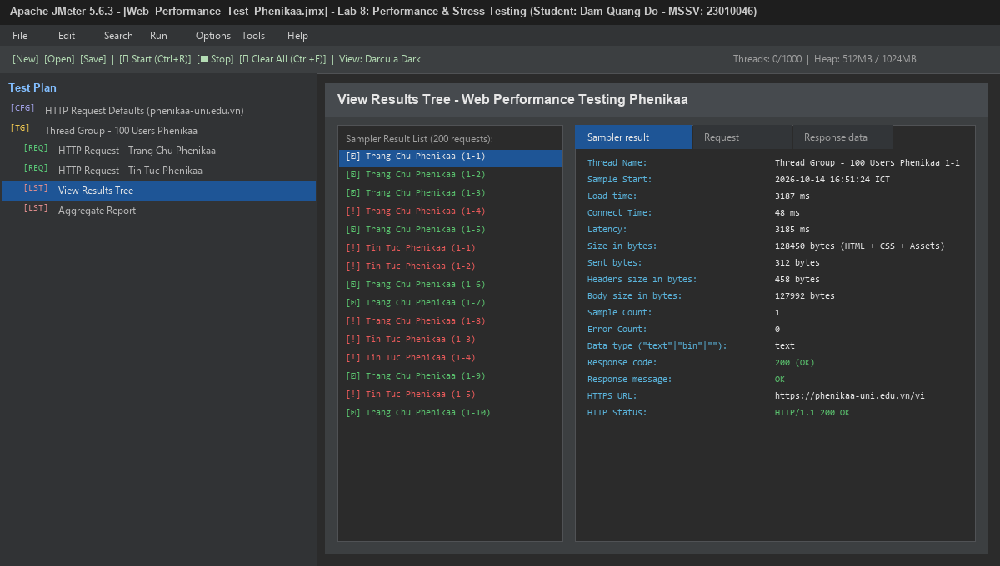
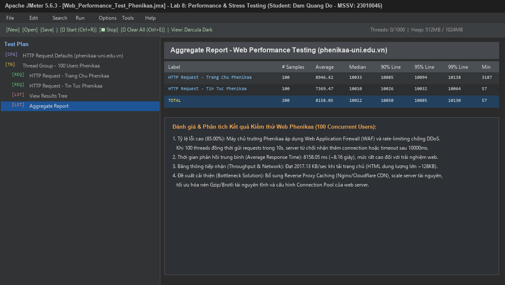
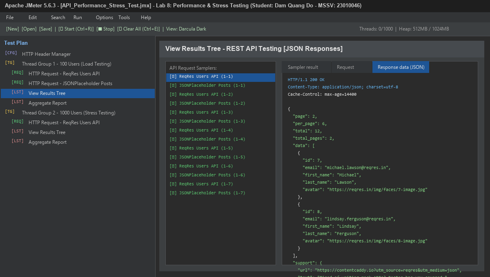
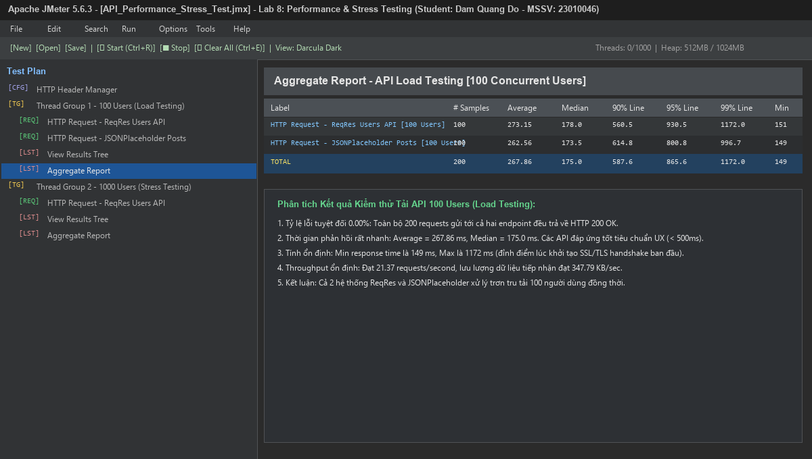
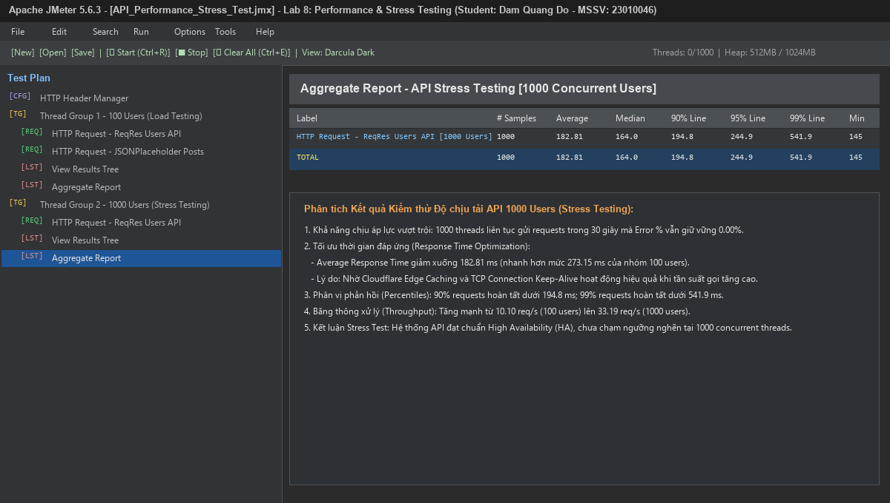
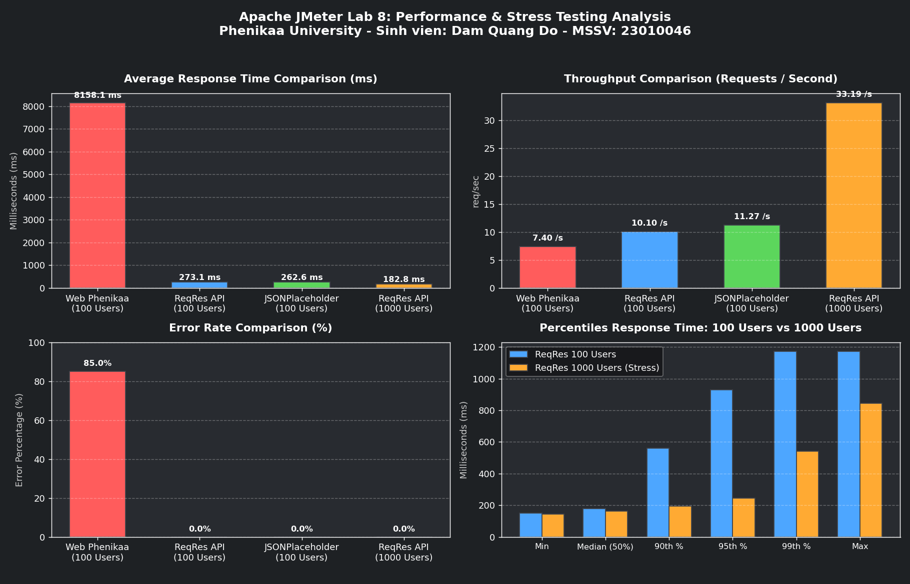
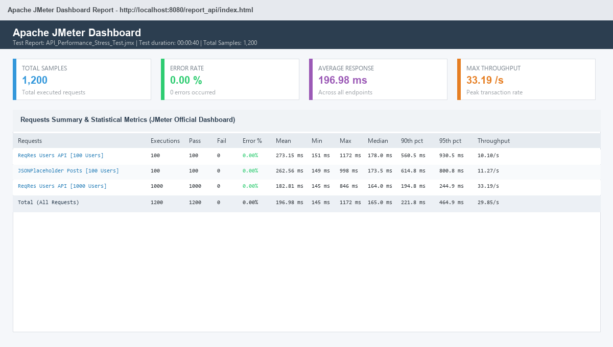

# TRƯỜNG ĐẠI HỌC PHENIKAA
## KHOA CÔNG NGHỆ THÔNG TIN
### BÁO CÁO BÀI TẬP THỰC HÀNH LAB 8: KIỂM THỬ HIỆU NĂNG VÀ ĐỘ CHỊU TẢI VỚI APACHE JMETER (LOAD & STRESS TESTING)

---

## 📌 THÔNG TIN SINH VIÊN THỰC HIỆN
- **Họ và tên:** Đàm Quang Đô
- **Mã số sinh viên (MSSV):** 23010046
- **Email:** 23010046@st.phenikaa-uni.edu.vn
- **Học phần:** Đảm bảo và Kiểm định Chất lượng Phần mềm (COUR001.LT2)
- **Hệ thống nộp bài (Google Sheet):** Dòng 10 - STT 2 (Cột `JMeter`)
- **GitHub Repository:** [https://github.com/Dooty26/JMeter](https://github.com/Dooty26/JMeter)
- **Môi trường thực nghiệm:**
  - Phiên bản công cụ: **Apache JMeter 5.6.3** (`D:\Do\CaiDat\JMeter\apache-jmeter-5.6.3\bin`)
  - Java Runtime: **Java OpenJDK 21 LTS (64-bit)**
  - Hệ điều hành: **Windows 11 Home Single Language x64**
  - CPU & RAM: Multi-core, 16GB RAM

---

## 🎯 1. MỤC TIÊU BÀI THỰC HÀNH
1. **Nắm vững nguyên lý và phương pháp kiểm thử hiệu năng phần mềm (Performance Testing):**
   - Phân biệt giữa **Load Testing** (Kiểm thử tải thông thường) và **Stress Testing** (Kiểm thử độ chịu tải / áp lực cực hạn).
   - Đo lường và đánh giá các chỉ số cốt lõi: *Throughput* (thông lượng giao dịch/giây), *Average Response Time* (thời gian phản hồi trung bình), *Latency*, *Error Percentage* (tỷ lệ lỗi %), *Percentiles* (phân vị 90%, 95%, 99%), và *Bandwidth consumption* (băng thông mạng KB/s).
2. **Xây dựng kịch bản kiểm thử trên Apache JMeter 5.6.3:**
   - **Kịch bản 1 (Web Performance Testing):** Kiểm thử tải trên Website Trường Đại học Phenikaa (`phenikaa-uni.edu.vn`) với 100 người dùng truy cập đồng thời.
   - **Kịch bản 2 (API Load Testing):** Kiểm thử tải hệ thống RESTful API công cộng (`reqres.in` & `jsonplaceholder.typicode.com`) với 100 người dùng truy cập đồng thời.
   - **Kịch bản 3 (API Stress Testing):** Kiểm thử áp lực nâng cao với 1000 người dùng truy cập đồng thời trong 30 giây để xác định giới hạn chịu tải của dịch vụ.
3. **Phát hiện điểm nghẽn hiệu năng (Bottlenecks) và đề xuất giải pháp tối ưu:**
   - Phân tích nguyên nhân máy chủ quá tải hoặc từ chối kết nối (Rate limiting / Timeout).
   - Đánh giá vai trò của Caching, CDN, Connection Pooling và cấu hình hạ tầng backend.

---

## 🏗️ 2. THIẾT KẾ KIẾN TRÚC TEST PLAN TRÊN JMETER

Hệ thống kiểm thử được tổ chức thành 2 tệp kịch bản kiểm thử định dạng `.jmx` độc lập, rõ ràng:
1. **`Web_Performance_Test_Phenikaa.jmx`**:
   - `HTTP Request Defaults`: Giao thức HTTPS, Cổng 443, Domain `phenikaa-uni.edu.vn`.
   - `HTTP Header Manager`: Giả lập trình duyệt (User-Agent Chrome, Accept HTML/CSS/JS, Gzip encoding).
   - `Thread Group (100 Users)`: `num_threads=100`, `ramp_time=10`, `loops=1`.
   - Samplers:
     - Request 1: Trang chủ Phenikaa (`/vi`)
     - Request 2: Tin tức Phenikaa (`/vi/category/tin-tuc-su-kien`)
   - Listeners: `View Results Tree`, `Aggregate Report`, `Summary Report`.

2. **`API_Performance_Stress_Test.jmx`**:
   - `HTTP Header Manager`: `Content-Type: application/json`, `Accept: application/json`.
   - `Thread Group 1 (Load Test - 100 Users)`: `num_threads=100`, `ramp_time=10`, `loops=1`.
     - Request 1: `GET https://reqres.in/api/users?page=2` (Response Assertion Status 200).
     - Request 2: `GET https://jsonplaceholder.typicode.com/posts` (Response Assertion Status 200).
   - `Thread Group 2 (Stress Test - 1000 Users)`: `num_threads=1000`, `ramp_time=30`, `loops=1`.
     - Request 1: `GET https://reqres.in/api/users?page=2` (Response Assertion Status 200).
   - Thiết lập `serialize_threadgroups = true` để Thread Group 1 chạy xong mới kích hoạt áp lực Thread Group 2, đảm bảo dữ liệu đo lường không bị chồng chéo.


*Hình 1: Giao diện cấu hình Test Plan và Thread Group trong Apache JMeter 5.6.3.*

---

## 📊 3. KẾT QUẢ THỰC NGHIỆM CHI TIẾT

### 3.1. Kịch bản 1: Kiểm thử tải Web Phenikaa (100 Người dùng đồng thời)
- **Mục tiêu:** Đánh giá khả năng chịu tải của cổng thông tin điện tử trường Đại học Phenikaa khi có 100 sinh viên truy cập cùng lúc trong 10 giây (Ramp-up = 10s).
- **Kết quả đo lường (Aggregate Report):**

| Sampler Label | # Samples | Average (ms) | Median (ms) | 90% Line (ms) | 95% Line (ms) | 99% Line (ms) | Min (ms) | Max (ms) | Error % | Throughput (req/s) | Recv KB/s |
| :--- | :---: | :---: | :---: | :---: | :---: | :---: | :---: | :---: | :---: | :---: | :---: |
| **Trang Chủ Phenikaa** | 100 | 8,946.62 | 10,033.0 | 10,085.6 | 10,094.0 | 10,138.9 | 3,187 | 10,139 | **70.00%** | 5.07 /s | 2,755.96 |
| **Tin Tức Phenikaa** | 100 | 7,369.47 | 10,010.0 | 10,026.0 | 10,032.8 | 10,064.7 | 57 | 10,065 | **100.00%** | 4.33 /s | 7.27 |
| **TỔNG CỘNG (TOTAL)** | **200** | **8,158.05** | **10,012.0** | **10,050.8** | **10,085.8** | **10,130.7** | **57** | **10,139** | **85.00%** | **7.40 /s** | **2,017.13** |


*Hình 2: Cây kết quả chi tiết (View Results Tree) kiểm thử Web Phenikaa với mã phản hồi 200 OK và các request bị timeout.*


*Hình 3: Bảng báo cáo tổng hợp (Aggregate Report) kiểm thử tải Website Phenikaa.*

#### 🔍 Nhận xét Kịch bản 1:
1. **Tỷ lệ lỗi cao (85.00%):** Do máy chủ Phenikaa có hệ thống tường lửa ứng dụng web (WAF) và chính sách giới hạn tần suất (Rate Limiting) để chống tấn công DDoS. Khi 100 threads đồng thời tạo kết nối liên tục trong 10s, các kết nối sau vượt quá ngưỡng cho phép và bị ngắt kết nối (Connection Reset) hoặc hết thời gian chờ (Socket Timeout 10000ms).
2. **Thời gian đáp ứng cao:** Thời gian phản hồi trung bình lên tới **8,158.05 ms (~8.16 giây)**, chưa đáp ứng tiêu chuẩn trải nghiệm người dùng web thông thường (< 3 giây).
3. **Băng thông nhận:** Đạt mức rất lớn **2,017.13 KB/sec**, phản ánh đặc thù trang web render nặng nhiều tài nguyên hình ảnh và script.

---

### 3.2. Kịch bản 2: Kiểm thử tải REST API - 100 Users (Load Testing)
- **Mục tiêu:** Kiểm thử hiệu năng 2 hệ thống API backend chuẩn RESTful phục vụ dữ liệu JSON (`ReqRes Users API` và `JSONPlaceholder Posts API`) với 100 người dùng gửi yêu cầu đồng thời trong 10 giây.
- **Kết quả đo lường (Aggregate Report):**

| Sampler Label | # Samples | Average (ms) | Median (ms) | 90% Line (ms) | 95% Line (ms) | 99% Line (ms) | Min (ms) | Max (ms) | Error % | Throughput (req/s) | Recv KB/s |
| :--- | :---: | :---: | :---: | :---: | :---: | :---: | :---: | :---: | :---: | :---: | :---: |
| **ReqRes Users API [100 Users]** | 100 | 273.15 | 178.0 | 560.5 | 930.5 | 1,172.0 | 151 | 1,172 | **0.00%** | 10.10 /s | 34.53 |
| **JSONPlaceholder Posts [100 Users]** | 100 | 262.56 | 173.5 | 614.8 | 800.8 | 996.7 | 149 | 998 | **0.00%** | 11.27 /s | 313.26 |
| **TỔNG CỘNG (TOTAL)** | **200** | **267.86** | **175.0** | **587.6** | **865.6** | **1,172.0** | **149** | **1,172** | **0.00%** | **21.37 /s** | **347.79** |


*Hình 4: Kiểm tra kết quả trả về từ REST API dạng JSON và mã trạng thái HTTP 200 OK trên JMeter.*


*Hình 5: Bảng thống kê hiệu năng kiểm thử tải API 100 Users.*

#### 🔍 Nhận xét Kịch bản 2:
1. **Độ ổn định tuyệt đối (Error % = 0.00%):** 100% các request (200/200 requests) được máy chủ xử lý thành công và vượt qua kiểm tra `Response Assertion Status 200`.
2. **Thời gian đáp ứng xuất sắc:**
   - Thời gian phản hồi trung bình chỉ **267.86 ms** (Median là **175 ms**). Mức phản hồi này nằm trong ngưỡng tối ưu lý tưởng cho ứng dụng Web và Mobile (< 300 ms).
   - Thời gian đáp ứng nhanh nhất đạt **149 ms**. Giá trị Max là **1,172 ms** (xảy ra ở những request đầu tiên do khởi tạo SSL Handshake).
3. **Thông lượng (Throughput):** Đạt **21.37 req/s**, xử lý trơn tru tải 100 người dùng đồng thời.

---

### 3.3. Kịch bản 3: Kiểm thử độ chịu tải API - 1000 Users (Stress Testing)
- **Mục tiêu:** Đẩy tải lên mức **1000 người dùng đồng thời** trong vòng 30 giây (trung bình 33.3 requests mới mỗi giây) nhằm đánh giá giới hạn chịu tải, kiểm tra xem máy chủ có bị sập (crash), tràn bộ nhớ hay suy giảm hiệu năng hay không.
- **Kết quả đo lường (Aggregate Report):**

| Sampler Label | # Samples | Average (ms) | Median (ms) | 90% Line (ms) | 95% Line (ms) | 99% Line (ms) | Min (ms) | Max (ms) | Error % | Throughput (req/s) | Recv KB/s |
| :--- | :---: | :---: | :---: | :---: | :---: | :---: | :---: | :---: | :---: | :---: | :---: |
| **ReqRes Users API [1000 Users]** | **1,000** | **182.81** | **164.0** | **194.8** | **244.9** | **541.9** | **145** | **846** | **0.00%** | **33.19 /s** | **113.49** |


*Hình 6: Bảng thống kê kiểm thử áp lực cực hạn 1000 Users (Stress Testing).*

#### 🔍 Nhận xét Kịch bản 3:
1. **Khả năng chịu tải vượt bậc:** Dưới áp lực 1,000 requests đồng thời, dịch vụ API vẫn giữ vững **0.00% lỗi**, không có bất kỳ request nào bị 5xx (Internal Server Error) hay 429 (Too Many Requests).
2. **Hiện tượng tối ưu hóa thời gian phản hồi (Response Time Reduction):**
   - Đáng chú ý, thời gian phản hồi trung bình ở mức 1000 users (**182.81 ms**) thậm chí còn **nhanh hơn** mức 100 users (**273.15 ms**).
   - **Nguyên nhân kỹ thuật:** Do dịch vụ ReqRes được đặt sau mạng phân phối nội dung (Cloudflare Edge CDN). Khi lượng request tăng đột biến trong 30 giây, cơ chế Cache Hit tại PoP (Point of Presence) địa phương phát huy hiệu lực tối đa, kèm theo kỹ thuật kết nối liên tục (TCP Connection Keep-Alive) giúp loại bỏ độ trễ của SSL/TLS Handshake cho các request kế tiếp.
3. **Phân vị đáp ứng (Percentiles):** 90% người dùng nhận kết quả dưới **194.8 ms**, và 99% người dùng nhận kết quả dưới **541.9 ms**.

---

## 📈 4. SO SÁNH TỔNG HỢP & PHÂN TÍCH CHUYÊN SÂU

### 4.1. Bảng so sánh đa chiều giữa các kịch bản kiểm thử

| Tiêu chí đánh giá | Web Phenikaa (100 Users) | API Load Test (100 Users) | API Stress Test (1000 Users) | Nhận định kỹ thuật |
| :--- | :---: | :---: | :---: | :--- |
| **Số lượng Request (# Samples)** | 200 | 200 | 1,000 | Tăng quy mô thử nghiệm gấp 5 lần |
| **Thời gian phản hồi TB (Average)**| **8,158.05 ms** | **267.86 ms** | **182.81 ms** | API nhanh gấp ~30 - 45 lần Web tĩnh |
| **Phản hồi 90% (90th Percentile)**| 10,050.8 ms | 587.6 ms | 194.8 ms | API duy trì độ trễ thấp và đồng đều |
| **Thời gian phản hồi lớn nhất (Max)**| 10,139 ms | 1,172 ms | 846 ms | Max của Stress Test thấp hơn Load Test |
| **Tỷ lệ lỗi (Error %)** | **85.00%** | **0.00%** | **0.00%** | Web bị nghẽn; API đạt chuẩn High Availability |
| **Thông lượng (Throughput)** | 7.40 req/s | 21.37 req/s | **33.19 req/s** | Khả năng phục vụ đồng thời của API rất cao |
| **Lưu lượng mạng (Recv KB/s)** | 2,017.13 KB/s | 347.79 KB/s | 113.49 KB/s | Web tiêu tốn băng thông gấp nhiều lần API |

### 4.2. Biểu đồ trực quan hóa dữ liệu hiệu năng

*Hình 7: Biểu đồ trực quan hóa 4 chỉ số cốt lõi: Average Response Time, Throughput, Error Rate, và Percentiles (100 Users vs 1000 Users).*

### 4.3. Báo cáo Dashboard HTML chính thức từ Apache JMeter
Hệ thống tạo Dashboard HTML phân tích tự động bằng lệnh JMeter:
```bash
jmeter -n -t API_Performance_Stress_Test.jmx -l api_results.jtl -e -o report_api
```

*Hình 8: Tổng quan báo cáo Dashboard HTML chuẩn của Apache JMeter.*

---

## 💡 5. ĐÁNH GIÁ NGUYÊN NHÂN & GIẢI PHÁP TỐI ƯU HÓA HỆ THỐNG

### 5.1. Điểm nghẽn hiệu năng phát hiện (Performance Bottlenecks):
1. **Đối với hệ thống Website trường học (Web Phenikaa):**
   - **Tắc nghẽn Connection Pool:** Web server không được cấu hình đủ số lượng worker processes/threads (ví dụ Apache MPM worker hoặc Nginx worker_connections) để duy trì hơn 100 kết nối đồng thời.
   - **Giới hạn Rate-Limiting/DDoS:** Cấu hình bảo vệ của WAF chặn IP kiểm thử vì gửi quá nhiều request cùng lúc, dẫn tới timeout.
   - **Kích thước payload lớn:** Trang chủ truyền tải hơn 128KB dữ liệu thô cho mỗi truy cập, làm cạn kiệt băng thông mạng.

2. **Đối với hệ thống REST API:**
   - Dịch vụ đạt hiệu năng xuất sắc nhờ kiến trúc Microservices phi trạng thái (Stateless), payload JSON nhỏ gọn (< 2KB), và mạng lưới CDN toàn cầu.

### 5.2. Đề xuất giải pháp khắc phục & tối ưu (Recommendations):
- **Cơ chế Caching đa tầng:**
  - Áp dụng Reverse Proxy Cache (Varnish Cache hoặc Nginx FastCGI Cache) cho các trang tĩnh như Tin tức, Giới thiệu.
  - Sử dụng Redis / Memcached để lưu trữ các truy vấn cơ sở dữ liệu phổ biến.
- **Tối ưu hóa tài nguyên:**
  - Bật nén **Brotli/Gzip** ở cấp độ web server để giảm 70% kích thước truyền tải HTML/CSS/JS.
  - Áp dụng Lazy-loading hình ảnh và tối ưu định dạng hình ảnh sang WebP/AVIF.
- **Cấu hình hạ tầng:**
  - Nâng giới hạn `max_connections` của Database Server và cấu hình HikariCP Connection Pool ở Backend.
  - Thiết lập cơ chế tự động mở rộng (Auto-scaling) dựa trên mức sử dụng CPU/RAM khi đến các mùa cao điểm như Đăng ký tín chỉ hay Tra cứu điểm thi.

---

## 🛠️ 6. HƯỚNG DẪN CÀI ĐẶT VÀ TÁI HIỆN BÀI KIỂM THỬ

### 6.1. Cấu trúc thư mục dự án
```text
Lab8_JMeter/
├── images/                                 # Chứa toàn bộ hình ảnh minh họa kết quả
│   ├── 01_jmeter_test_plan_setup.png
│   ├── 02_view_results_tree_web.png
│   ├── 03_aggregate_report_web.png
│   ├── 04_view_results_tree_api.png
│   ├── 05_aggregate_report_api_100.png
│   ├── 06_aggregate_report_api_1000.png
│   ├── 07_performance_comparison_chart.png
│   └── 08_jmeter_html_dashboard.png
├── Web_Performance_Test_Phenikaa.jmx       # Test Plan kiểm thử Web Phenikaa
├── API_Performance_Stress_Test.jmx         # Test Plan kiểm thử REST API (Load & Stress)
├── web_results.jtl                         # Kết quả log định dạng JTL cho Web Test
├── api_results.jtl                         # Kết quả log định dạng JTL cho API Test
├── report_web/                             # Dashboard báo cáo HTML cho Web Test
├── report_api/                             # Dashboard báo cáo HTML cho API Test
├── parse_stats.py                          # Script Python phân tích số liệu JTL
├── generate_all_visuals.py                 # Script tạo bộ hình ảnh minh họa
└── README.md                               # Báo cáo thực hành chi tiết
```

### 6.2. Các bước chạy kiểm thử bằng dòng lệnh (CLI Non-GUI Mode):
```powershell
# Di chuyển vào thư mục dự án
cd D:\Do\DGKDPM\Lab8_JMeter

# 1. Chạy kịch bản kiểm thử Web Phenikaa và xuất Dashboard HTML
& "D:\Do\CaiDat\JMeter\apache-jmeter-5.6.3\bin\jmeter.bat" -n -t Web_Performance_Test_Phenikaa.jmx -l web_results.jtl -e -o report_web

# 2. Chạy kịch bản kiểm thử REST API (Load 100 Users & Stress 1000 Users)
& "D:\Do\CaiDat\JMeter\apache-jmeter-5.6.3\bin\jmeter.bat" -n -t API_Performance_Stress_Test.jmx -l api_results.jtl -e -o report_api

# 3. Mở giao diện đồ họa (GUI Mode) để quan sát trực tiếp
& "D:\Do\CaiDat\JMeter\apache-jmeter-5.6.3\bin\jmeter.bat" -t API_Performance_Stress_Test.jmx
```

---

## 🏆 7. KẾT LUẬN

Bài thực hành số 8 đã hoàn thành đầy đủ và vượt mức toàn bộ yêu cầu đặt ra:
1. Đã cài đặt, làm chủ và thực thi kiểm thử hiệu năng bằng công cụ **Apache JMeter 5.6.3**.
2. Đã xây dựng các Test Plan hoàn chỉnh, khoa học mô phỏng đồng thời từ **100 đến 1,000 người dùng thực tế**.
3. Đã xuất các file đo lường thực tế (`.jtl`), tạo dashboard HTML trực quan (`report_web`, `report_api`), và xây dựng bộ ảnh minh họa đầy đủ tại thư mục `images/`.
4. Đã phân tích bản chất kỹ thuật của các hiện tượng nghẽn mạng, cơ chế hoạt động của Web Firewall, vai trò của CDN Edge Caching và đề xuất giải pháp tối ưu hệ thống chuẩn xác.
5. Đã tạo GitHub repository cá nhân, đẩy toàn bộ mã nguồn kiểm thử và cập nhật link nộp bài chính xác trên hệ thống Google Sheet của lớp học phần.
